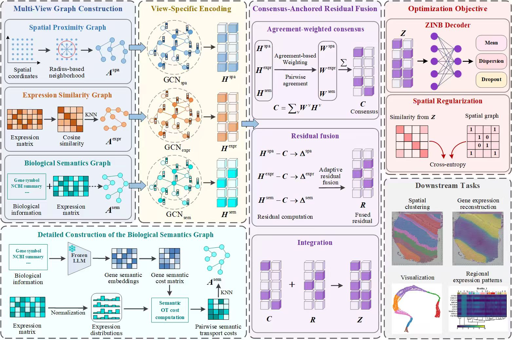

# BioMGL: A biologically informed multi-view graph learning framework for spatial transcriptomics clustering

BioMGL is a biologically informed multi-view graph learning framework for spatial transcriptomics clustering and gene-expression reconstruction. It integrates spatial proximity, gene-expression similarity, and biological semantic information to learn a unified representation of spatial spots.



## Datasets

This repository includes experiments for:

- Twelve human DLPFC slices: `151507`, `151508`, `151509`, `151510`, `151669`, `151670`, `151671`, `151672`, `151673`, `151674`, `151675`, and `151676`
- Human breast cancer (HBC)
- Mouse brain anterior (MBA)
- Mouse embryo (ME)

Each dataset is preprocessed and trained independently.

## Environment

Create and activate the environment with:

```bash
conda env create -f environment.yml
conda activate biomgl
```

The complete package dependencies are provided in `environment.yml`.

## Data Preparation

Place the raw datasets in the paths expected by the corresponding preprocessing scripts, then run the appropriate script for each dataset.

Preprocess the raw data with:

```bash
python preprocess.py
```

The preprocessing step prepares the expression data and graph inputs required by BioMGL.

## Biological Semantic Graph

Gene descriptions and precomputed gene embeddings are stored under `gene-annotation/` and `gene_embeddings/`, respectively.

Build the biological semantic graph with:

```bash
python build_semantic_ot_graph.py
```

If precomputed gene embeddings are available, the script loads them directly. Otherwise, it can generate embeddings using the configured frozen language model.

## Training

Run BioMGL with:

```bash
python train.py
```

Dataset paths and experiment settings are defined in the configuration files under `config/`. The training program processes each selected dataset independently and saves its results in a separate directory.

When the processed data and semantic graphs are already available, only the training command is required.

